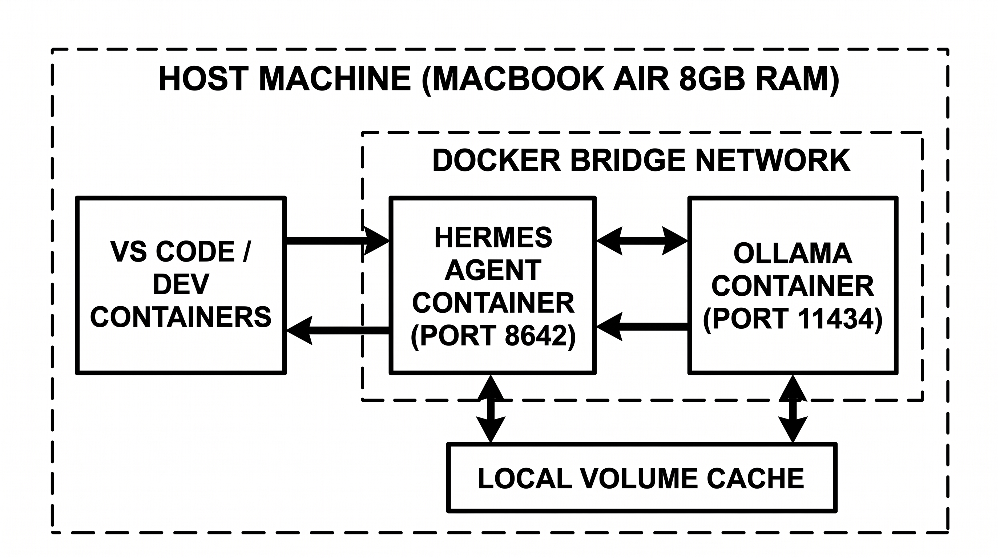
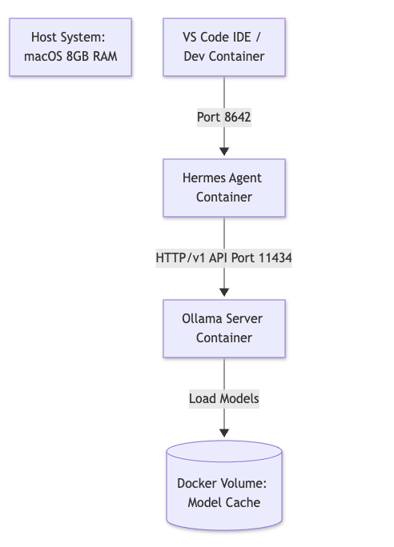
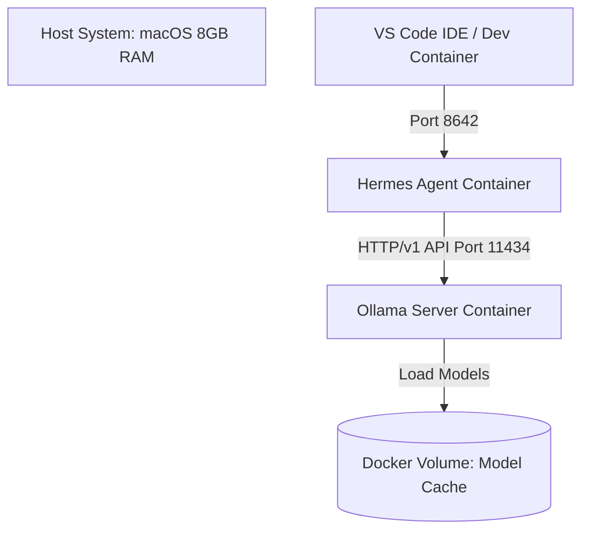
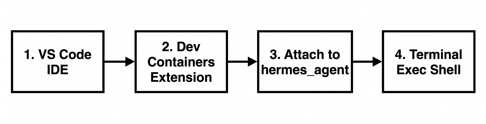

# Fully Local Agentic Environment: Hermes Agent + Ollama (Dockerized)



<!-- Badges -->


> **A fully localized, private, and containerized AI agent environment** orchestrated using Infrastructure as Code (IaC) via Docker Compose. This setup pairs **Hermes Agent** (agentic framework) with **Ollama** (backend inference engine) running on small-scale local models optimized for limited hardware constraints.

---

## 📑 Table of Contents

- [Overview](#-overview)
- [Features](#-features)
- [Architecture](#-architecture)
- [Problem Definition & Research](#-problem-definition--research)
- [Methods & System Specifications](#-methods--system-specifications)
- [Analysis & Comparative Model Testing](#-analysis--comparative-model-testing)
- [Quick Start](#-quick-start)
- [Infrastructure as Code (IaC) Deployment](#-infrastructure-as-code-iac-deployment)
- [VS Code Integration](#-vs-code-integration)
- [Usage Examples](#-usage-examples)
- [Encountered Hurdles & Solutions](#-encountered-hurdles--solutions)
- [Project Structure](#-project-structure)
- [Roadmap](#-roadmap)
- [Contributing](#-contributing)
- [FAQ](#-faq)
- [Acknowledgements](#-acknowledgements)
- [License](#-license)

---

## 🔍 Overview

Deploying autonomous AI agents typically relies on cloud-hosted LLM APIs (e.g., OpenAI, Anthropic), introducing data privacy concerns, latency, subscription costs, and vendor lock-in. Running local agents usually requires high-end GPUs; executing an end-to-end agentic workflow locally on low-memory consumer hardware (e.g., 8 GB RAM MacBook Air) presents significant resource bottlenecks.

This project demonstrates that a **fully localized, containerized AI agent** can run reliably on an 8 GB Apple Silicon MacBook Air using quantized small language models—with zero external network calls for inference.

---

## ✨ Features

- 🔒 **100% Local & Private Execution** — Zero external network calls for model inference or agent execution.
- ⚡ **Low-Resource Optimization** — Maintains stability without exceeding the 8 GB RAM limit.
- 🏗️ **Infrastructure as Code (IaC)** — Reproducible, single-command setup via Docker Compose.
- 🧑‍💻 **Developer Integration** — Seamless attach capabilities via VS Code Dev Containers.
- 🤖 **Multi-Model Support** — Benchmarked `llama3.2:1b` (fast, lightweight) and `llama3.1:8b` (high-accuracy reasoning).
- 🔁 **Reproducible Benchmarks** — Identical containerized workloads across models.
- 📦 **Auto-Provisioning** — One script pulls models and configures the Hermes provider.

---

## 🏛️ Architecture




| Component | Role | Port |
| :--- | :--- | :--- |
| **Hermes Agent** | Agentic orchestration framework | `8642`, `9119` |
| **Ollama** | Local LLM inference backend | `11434` |
| **Docker Volumes** | Persistent model cache & agent data | — |
| **VS Code Dev Containers** | IDE attach & terminal access | — |

---

## 🧩 Problem Definition & Research

### Problem Statement
Deploying autonomous AI agents typically relies on cloud-hosted LLM APIs (e.g., OpenAI, Anthropic), introducing data privacy concerns, latency, subscription costs, and vendor lock-in. Running local agents usually requires high-end GPUs; executing an end-to-end agentic workflow locally on low-memory consumer hardware (e.g., 8 GB RAM MacBook Air) presents significant resource bottlenecks.

### Primary Objectives
* **100% Local & Private Execution:** Zero external network calls for model inference or agent execution.
* **Low-Resource Optimization:** Maintain stability without exceeding 8 GB RAM limit.
* **Infrastructure as Code (IaC):** Reproducible, single-command setup.
* **Developer Integration:** Seamless attach capabilities via VS Code Dev Containers.

---

## 🛠️ Methods & System Specifications

### Hardware & Operating Environment
| Component | Specification |
| :--- | :--- |
| **Host Machine** | MacBook Air (Apple Silicon M-Series) |
| **Unified Memory** | 8 GB |
| **Containerization** | Docker Desktop & Docker Compose |
| **IDE** | Visual Studio Code + Remote - Containers |

### Evaluated Models
| Model | Tag | Size Class | Purpose |
| :--- | :--- | :--- | :--- |
| Llama 3.2 | `llama3.2:1b` | 1B | Lightweight general reasoning & instruction following |
| Llama 3.1 | `llama3.1:8b` | 8B | Full-scale reasoning & high-accuracy tool calling |

---

## 📊 Analysis & Comparative Model Testing

Both models were benchmarked inside the containerized environment under identical workloads (tool usage and multi-turn agent execution):

| Benchmark Metric | `llama3.2:1b` | `llama3.1:8b` |
| :--- | :--- | :--- |
| **RAM Footprint (Idle)** | ~1.2 GB | ~5.1 GB |
| **RAM Footprint (Peak)** | ~2.1 GB | ~6.8 GB |
| **Inference Speed (Tokens/sec)** | ~28–34 t/s | ~6–9 t/s |
| **Tool Calling Accuracy** | Moderate | High |
| **8 GB System Viability** | ✅ Excellent (Minimal overhead) | ⚠️ Marginal (Pushes memory ceiling) |

**Analysis Decision:** `llama3.2:1b` serves as the primary default model for low-latency agentic loops, while `llama3.1:8b` is allocated for complex multi-step reasoning and structured tool-calling tasks—though it should be run with caution on 8 GB systems due to swap pressure and reduced throughput.

---

## 🚀 Quick Start

### Prerequisites

- [Docker Desktop](https://www.docker.com/products/docker-desktop/) (with Compose v2)
- [Git](https://git-scm.com/)
- (Optional) [VS Code](https://code.visualstudio.com/) + [Dev Containers extension](https://marketplace.visualstudio.com/items?itemName=ms-vscode-remote.remote-containers)
- macOS on Apple Silicon (tested) — Linux/Windows should work with GPU passthrough considerations

### Installation

```bash
# 1. Clone the repository
git clone https://github.com/m0hesepshdoh/hermes-ollama-local.git
cd hermes-ollama-local

# 2. Make the setup script executable
chmod +x setup.sh

# 3. Run the automated provisioning script
./setup.sh
```

### One-Line Launch

```bash
docker compose up -d && docker exec -it ollama ollama pull llama3.2:1b
```

---

## 🏗️ Infrastructure as Code (IaC) Deployment

### File: `docker-compose.yml`

```yaml
version: '3.8'

services:
  ollama:
    image: ollama/ollama:latest
    container_name: ollama
    ports:
      - "11434:11434"
    volumes:
      - ollama_data:/root/.ollama
    restart: unless-stopped

  hermes:
    image: nousresearch/hermes-agent:latest
    container_name: hermes_agent
    ports:
      - "8642:8642"
      - "9119:9119"
    environment:
      - OLLAMA_BASE_URL=http://ollama:11434
    command: ["tail", "-f", "/dev/null"]
    volumes:
      - hermes_data:/opt/data
    depends_on:
      - ollama
    restart: unless-stopped

volumes:
  ollama_data:
  hermes_data:
```

### Automation Provisioning Script (`setup.sh`)

```bash
#!/bin/bash
set -e

echo "=== Spinning up IaC Local Agent Environment ==="
docker compose up -d

echo "=== Waiting for Ollama to be ready ==="
until curl -s http://localhost:11434/api/tags > /dev/null; do
  sleep 2
done

echo "=== Pulling Local Models ==="
docker exec -it ollama ollama pull llama3.2:1b
docker exec -it ollama ollama pull llama3.1:8b

echo "=== Configuring Hermes Agent Provider ==="
docker exec -it hermes_agent hermes config set providers.default ollama
docker exec -it hermes_agent hermes config set providers.ollama.base_url http://ollama:11434/v1

echo "=== Setup Complete! ==="
echo "Run: docker exec -it hermes_agent hermes chat --model ollama/llama3.2:1b"
```

---

## 💻 VS Code Integration



To develop, attach, and execute code directly inside the Dockerized Agent environment using VS Code:

1. **Install Extensions:** Install the **Dev Containers** (`ms-vscode-remote.remote-containers`) extension in VS Code.
2. **Open Command Palette:** Press `Cmd + Shift + P` (or `Ctrl + Shift + P`).
3. **Attach to Container:** Select **Dev Containers: Attach to Running Container...**
4. **Select Container:** Choose `hermes_agent`.
5. **Access Terminal:** Open a new terminal inside VS Code (`Ctrl + ~`); you now have direct bash access to the localized agent environment.

---

## 🧪 Usage Examples

### Chat with the default lightweight model

```bash
docker exec -it hermes_agent hermes chat --model ollama/llama3.2:1b
```

### Chat with the high-accuracy model (memory permitting)

```bash
docker exec -it hermes_agent hermes chat --model ollama/llama3.1:8b
```

### Verify models available

```bash
docker exec -it ollama ollama list
```

### Test the Ollama API directly

```bash
curl http://localhost:11434/api/generate -d '{
  "model": "llama3.2:1b",
  "prompt": "Explain agentic AI in one sentence."
}'
```

### Stream container logs

```bash
docker compose logs -f
```

### Stop the environment

```bash
docker compose down
```

### Full teardown (including model cache)

```bash
docker compose down -v
```

---

## 🧱 Encountered Hurdles & Solutions

<details>
<summary><strong>1. Container Auto-Shutdown (Non-Interactive TTY)</strong></summary>

- **Problem:** Hermes container exited immediately upon startup.
- **Solution:** Injected `command: ["tail", "-f", "/dev/null"]` in `docker-compose.yml` to preserve daemon execution.
</details>

<details>
<summary><strong>2. API Endpoint Route Mismatch (404 Error)</strong></summary>

- **Problem:** Initial requests failed with `HTTP 404: page not found`.
- **Solution:** Configured Ollama base URL explicitly with `/v1` suffix (`http://ollama:11434/v1`).
</details>

<details>
<summary><strong>3. Memory Pressure with <code>llama3.1:8b</code> on 8 GB Host</strong></summary>

- **Problem:** Loading the 8B model alongside Docker Desktop and VS Code pushed unified memory to its ceiling, triggering macOS swap and severe slowdowns.
- **Solution:** Reserved `llama3.1:8b` for occasional high-accuracy tasks, kept `llama3.2:1b` as the default, and ensured no other memory-heavy apps were running during 8B inference.
</details>

---

## 📁 Project Structure

```
hermes-ollama-local/
├── assets/
│   ├── architecture.jpeg
│   └── vscode_docker_flow.jpeg
├── docker-compose.yml
├── setup.sh
├── README.md
└── LICENSE
```

---

## 🗺️ Roadmap

- [x] Dockerized Hermes + Ollama stack
- [x] IaC provisioning script
- [x] Benchmark `llama3.2:1b` vs `llama3.1:8b`
- [x] VS Code Dev Container attach flow
- [ ] Add Linux + NVIDIA GPU compose override
- [ ] Add `devcontainer.json` for one-click VS Code setup
- [ ] CI workflow to validate `docker-compose.yml`
- [ ] Support for `qwen2.5:3b` as a middle-ground model
- [ ] Add structured-output retry middleware example

---

## 🤝 Contributing

Contributions are welcome! Please follow these steps:

1. Fork the repository
2. Create a feature branch: `git checkout -b feature/amazing-feature`
3. Commit your changes: `git commit -m 'feat: add amazing feature'`
4. Push to the branch: `git push origin feature/amazing-feature`
5. Open a Pull Request

Please ensure your PRs follow the [Conventional Commits](https://www.conventionalcommits.org/) spec and include updated benchmarks where relevant.

---

## ❓ FAQ

<details>
<summary><strong>Can I run this on Windows or Linux?</strong></summary>

Yes—Docker Compose is cross-platform. On Linux with an NVIDIA GPU, add a `deploy.resources.reservations.devices` block to the Ollama service for GPU passthrough. Windows users should use WSL2 with Docker Desktop.
</details>

<details>
<summary><strong>Why two models?</strong></summary>

`llama3.2:1b` is fast and memory-friendly, ideal for iterative agent loops. `llama3.1:8b` provides significantly better tool-calling accuracy and structured output, but requires more RAM and is slower. Keeping both lets you choose per-task.
</details>

<details>
<summary><strong>Does this make any external network calls?</strong></summary>

Only during the initial image pull and model download. After setup, all inference happens locally—no telemetry, no API calls.
</details>

<details>
<summary><strong>How do I free up disk space?</strong></summary>

Run `docker compose down -v` to remove volumes (including model cache), or `docker exec -it ollama ollama rm <model>` to remove a specific model.
</details>

<details>
<summary><strong>Can I use a larger model?</strong></summary>

You can, but 8 GB of unified memory is a hard ceiling. Models above ~8B parameters will swap heavily. For more headroom, consider `qwen2.5:3b` or `phi3:mini` as middle-ground options.
</details>

---

## 🙏 Acknowledgements

- [Ollama](https://ollama.com/) — Local LLM inference engine
- [Nous Research Hermes Agent](https://github.com/NousResearch) — Agentic framework
- [Docker](https://www.docker.com/) — Containerization platform
- [Meta Llama](https://llama.meta.com/) — Open-weight models

---

## 📄 License

This project is licensed under the **MIT License** — see the [LICENSE](LICENSE) file for details.

---

<div align="center">

**⭐ If this project helped you run agents locally, consider giving it a star! ⭐**

Made with ❤️ for the local-first AI community

</div>